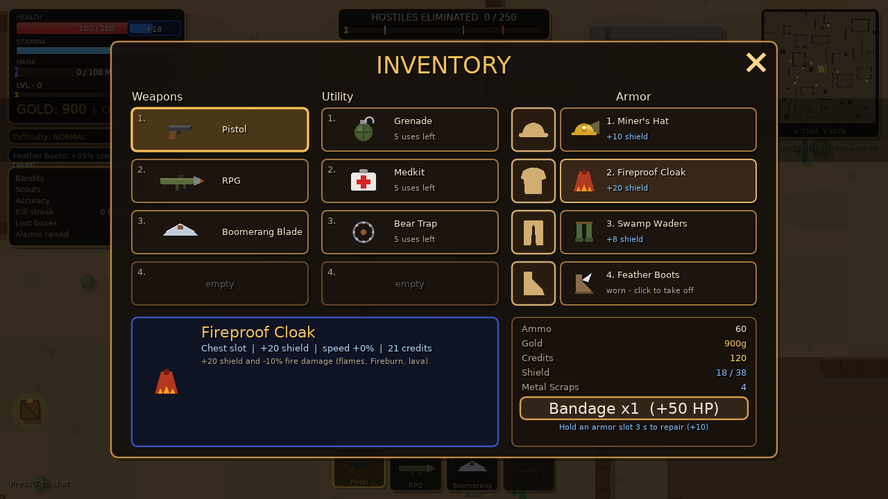
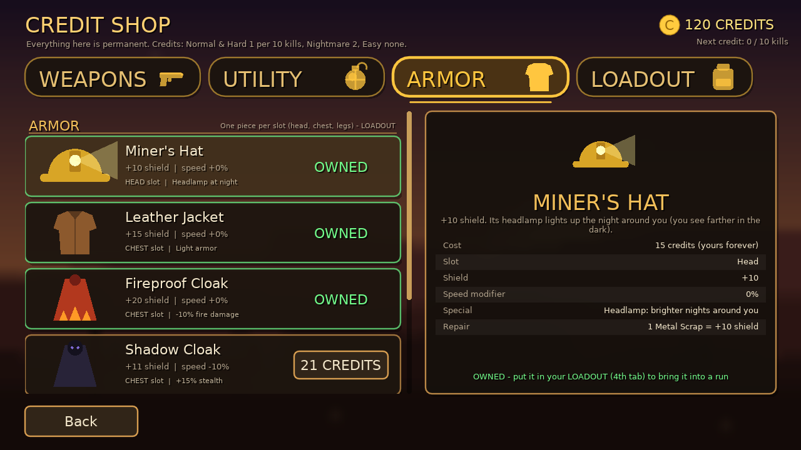
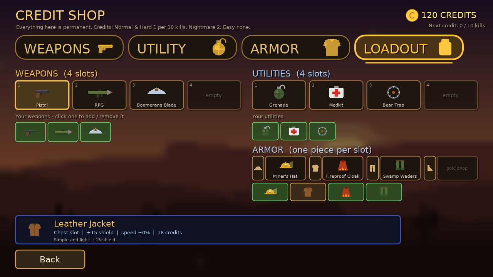
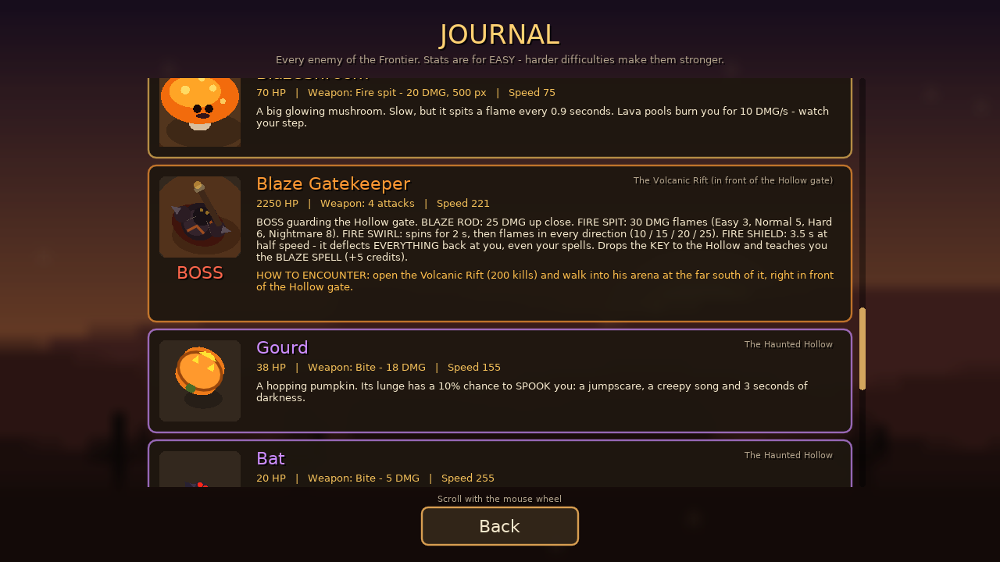

# Frontier

A top-down 2D open-world shooter made with [LÖVE](https://love2d.org) (Lua). Fight across five regions, beat two bosses, or survive the waves of Endless mode, alone or with up to 4 friends over LAN.



## Features

- **Two modes**
  - **Story**: cross the Dustbowl Frontier, Frozen Wastes, Murky Swamp, Volcanic Rift and Haunted Hollow. Beat the **Blaze Gatekeeper**, then the **Guardian of the Hollow**.
  - **Endless**: no final boss. A new wave comes every day, and wave 5 is the LAST WAVE.
- **4 difficulties**: Easy, Normal, Hard and Nightmare.
- **Gear**
  - 27 weapons.
  - 8 utilities: grenades, medkits, smoke bombs, bear traps, decoys, sentry turrets and more.
  - Armor with a shield, in four slots: head, chest, legs and feet.
- **Credit Shop**: permanent unlocks, Loot Crates and a Loadout (4 weapons, 4 utilities and armor).
- **Progression**: levels, spells, day and night, weather, random events, achievements and a Journal of every enemy.
- **LAN multiplayer** for up to 4 players, with hearts, revives and chat.
- **No asset files**: all graphics and sounds are generated in code.

| Credit Shop | Loadout | Journal |
|---|---|---|
|  |  |  |

## Play

**Windows:** download `Frontier-Windows.zip` from the [Releases](../../releases) page, unzip it and run `Frontier.exe`.

**From source (any OS):**

1. Install [LÖVE 11.5](https://love2d.org).
2. In this folder, run:

```
love .
```

## Controls

| Key | Action |
|---|---|
| W A S D | Move |
| Left click | Shoot / use the selected utility |
| Right click | Block (hold) |
| Mouse wheel | Select a hotbar slot |
| G | Switch the hotbar: guns ↔ utilities |
| Space | Dash |
| B | Spellbook (click a spell to cast it) |
| P | Inventory |
| H | Gold shop |
| E | Merchant / shed chest |
| V | Revive a downed teammate (hold) |
| R | Respawn now (when down, multiplayer) |
| T | Chat |
| K | Keybind guide |
| F | Toggle HUD |
| Esc | Pause / close menus |

## Project layout

| File | What it contains |
|---|---|
| `main.lua` | The game: world, enemies, combat, UI and multiplayer |
| `weapons.lua` | Weapon stats (damage, fire rate, range, prices, crate odds) |
| `utility.lua` | Utility stats (uses per run, cooldowns, prices) |
| `armor.lua` | Armor pieces and slots |
| `enemies.lua` | Enemy stats and Journal texts |
| `net.lua` | LAN networking (ENet + UDP discovery) |
| `profile.lua` | Saved player data (credits, unlocks, records, loadout) |
| `conf.lua` | LÖVE window settings |

To balance the game, edit the data files (`weapons.lua`, `utility.lua`, `armor.lua`, `enemies.lua`). Each file starts with a comment explaining its fields.

## Building

```
./tools/build.sh
```

The script (Linux, macOS or Git Bash on Windows) creates:

- `dist/frontier.love`: the game as a single file, runnable with LÖVE.
- `dist/Frontier-Windows/Frontier.exe` with its DLLs, and `dist/Frontier-Windows.zip`, ready to upload to a release.

On Windows without Git Bash, run `tools\build.bat` instead. It needs LÖVE installed in `C:\Program Files\LOVE`, or `LOVE_DIR` set to its folder.

## Contributing

1. Create a branch: `git checkout -b my-change`
2. Commit your changes and push the branch.
3. Open a Pull Request into `main`.
